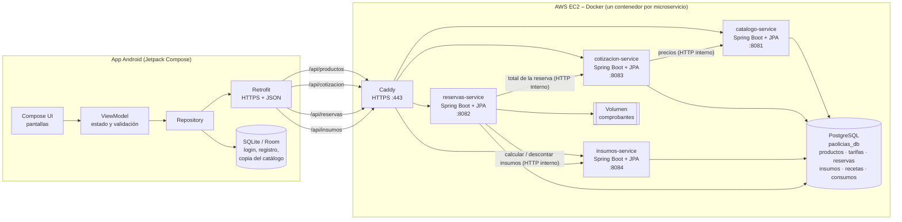
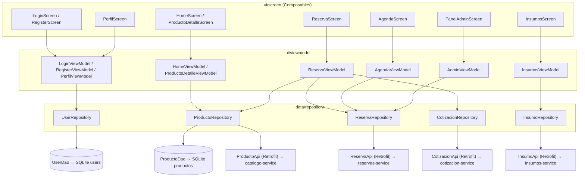
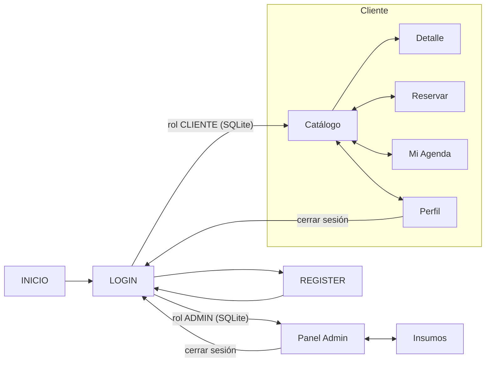

# Paolicias.Sweet – Diagramas de arquitectura

> Esta carpeta va en la rama **`documents`** del repositorio Android (entregable 3 de la rúbrica).
> Los diagramas están en Mermaid: GitHub los dibuja solo al abrir este archivo.

## 1. Arquitectura de microservicios

| Microservicio | Tabla | Endpoints principales |
|---|---|---|
| catalogo-service | `productos` | `GET /api/productos`, `GET /api/productos/{id}`, `POST /api/productos` |
| cotizacion-service | `tarifas` | `POST /api/cotizacion`, `GET /api/tarifas` |
| reservas-service | `reservas` | `POST/GET /api/reservas`, `GET /api/reservas/{id}/insumos`, `POST/GET /api/reservas/{id}/comprobante`, `PATCH /api/reservas/{id}/validar · rechazar · completar` |
| insumos-service | `insumos`, `recetas`, `consumos` | `GET /api/insumos`, `PATCH /api/insumos/{id}/stock`, `POST /api/insumos/calculo`, `POST /api/insumos/consumos` |

## 2. Arquitectura del proyecto Android (MVVM + Repository)

## 3. Navegación por rol

## 4. Recursos nativos por rol

| Rol | Recurso | Dónde | Permiso |
|---|---|---|---|
| Cliente | Cámara (foto del comprobante) | Mi Agenda | Ninguno: usa la app de cámara del sistema y un `FileProvider` privado |
| Cliente | Galería (selector de fotos) | Mi Agenda | Ninguno: `PickVisualMedia` |
| Cliente | Vibración al confirmar la reserva | Reservar | `VIBRATE` (normal) |
| Admin | Notificación de comprobantes por revisar | Panel Admin | `POST_NOTIFICATIONS`, pedido en tiempo de ejecución (Android 13+) |
| Admin | Vibración al validar / rechazar | Panel Admin | `VIBRATE` (normal) |
| Admin | Correo al cliente (intent) | Panel Admin | Ninguno |

## 5. Flujo del abono

```mermaid
stateDiagram-v2
    [*] --> Pendiente: cliente envía la reserva
    Pendiente --> EnRevision: cliente adjunta comprobante
    EnRevision --> EnRevision: cliente cambia comprobante
    EnRevision --> Pagado50: admin valida (se descuentan los insumos; si faltan, no deja)
    EnRevision --> Pendiente: admin rechaza
    Pagado50 --> Completado: admin marca completada
    Completado --> [*]
```

